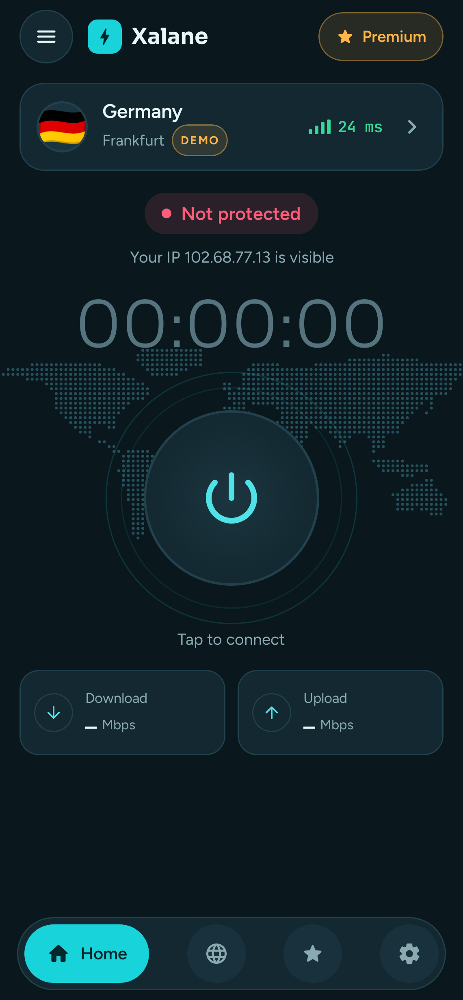
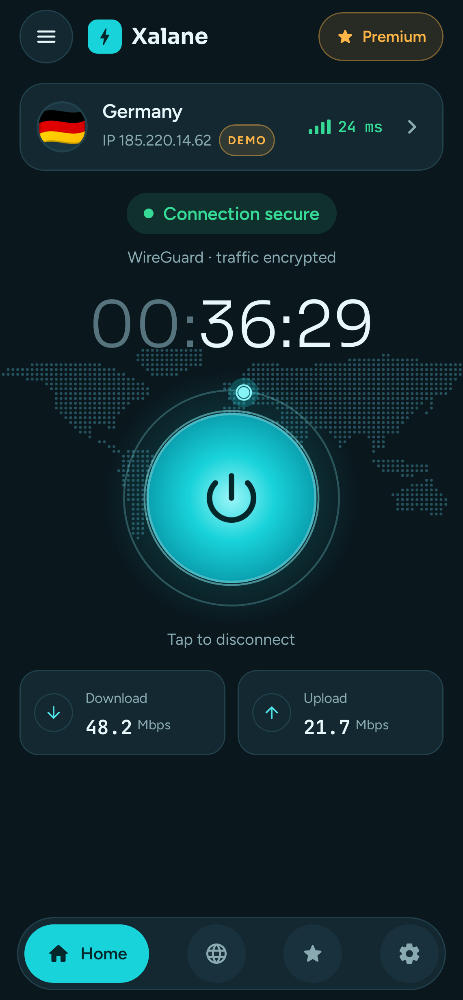
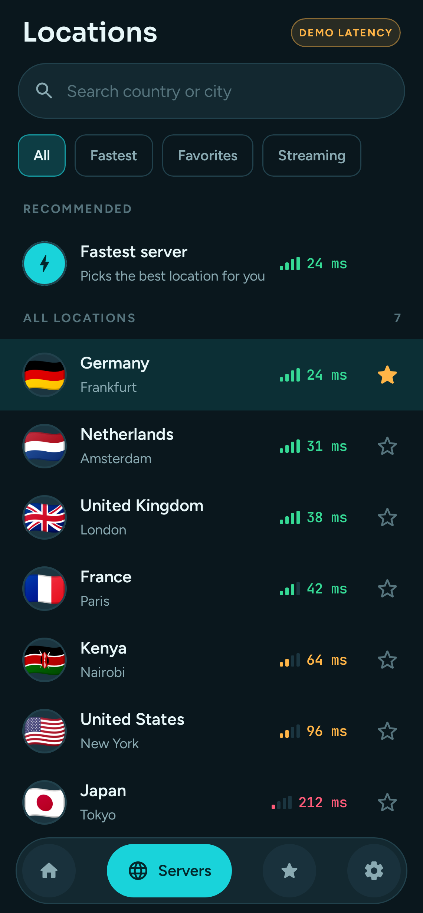
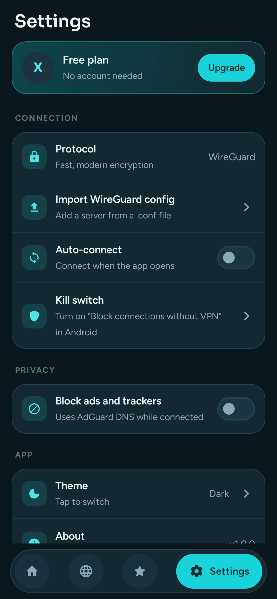
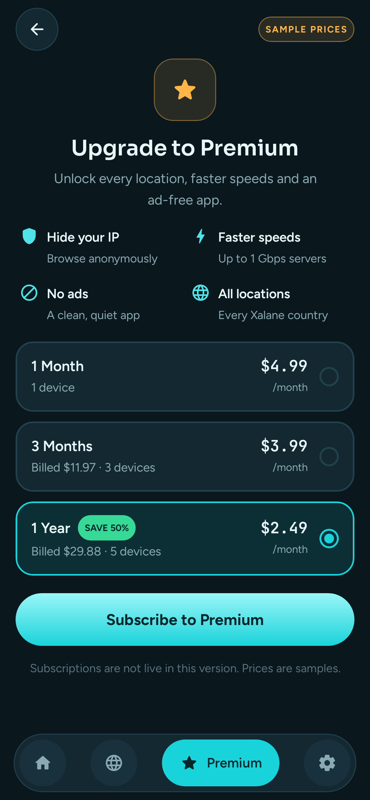

# Xalane VPN for Android

Version 1 of the Xalane VPN app: Kotlin, Jetpack Compose and the official WireGuard engine.

| Home | Connected | Servers | Settings | Premium |
|---|---|---|---|---|
|  |  |  |  |  |

## What works in v1

- **Real VPN connections** using WireGuard (`com.wireguard.android:tunnel`). Android shows its standard VPN permission prompt the first time.
- **Import your own server**: Settings → *Import WireGuard config* accepts any standard `.conf` file. Imported servers appear under *Your servers* and connect for real.
- **Home**: connect button, session timer, live download and upload speed, and your public IP (before and after connecting).
- **Servers**: search, filters (Fastest, Favorites, Streaming), favorites, and an automatic *Fastest server* option.
- **Settings**: auto-connect, ad and tracker blocking (AdGuard DNS while connected), dark, light or system theme, and a shortcut to Android's kill switch (*Block connections without VPN*).
- **Splash** and **Premium** screens matching the approved design.

## What is still Demo

- The 13 built-in locations in `app/src/main/assets/servers.json` are **Demo**: they show sample latency and cannot connect yet. They are labeled Demo in the app. A location becomes live as soon as its entry gets a `wireguardConfig` (full config text), which the Xalane backend will provide later.
- **Premium** prices are samples. Subscriptions (Google Play Billing) are not connected yet.

## Build

Requirements: JDK 17+ and the Android SDK (platform 35).

```bash
./gradlew assembleDebug
```

The APK is written to `app/build/outputs/apk/debug/app-debug.apk`.

For Google Play, build the signed bundle with `./gradlew bundleRelease`. It is signed with the upload key from `keystore.properties` (kept out of git); without that file, release builds fall back to the debug key. The release build hides Demo locations and the Premium screen. See [docs/play-store](docs/play-store/README.md) for the full publishing guide.

## Tests

```bash
./gradlew testDebugUnitTest
```

This runs logic tests plus screenshot tests (Robolectric + Roborazzi) that render every screen to `app/build/outputs/roborazzi/`. If Maven Central rate-limits downloads, set `ROBOLECTRIC_REPO_URL` to a Maven Central mirror.

## Project layout

```
app/src/main/java/com/xalane/vpn/
  data/        servers (bundled + imported configs), settings (DataStore)
  vpn/         WireGuard tunnel manager, public IP lookup
  ui/          view model, app root, theme, components, screens
backend/      control API (FastAPI), Docker deployment, admin CLI
node/         VPN server setup script and sync agent
docs/         approved design preview, screenshots, Play Store kit
```

## Backend

The Xalane control API and the VPN node agent live in [`backend/`](backend/README.md) and [`node/`](node/). Build the app with `-PxalaneApiUrl=https://your-api` and it lists the Xalane servers and connects to them automatically. Each phone registers anonymously with its own WireGuard key.

## Next steps

1. Deploy the API and the first VPN servers (see [backend/README.md](backend/README.md)).
2. Google Play Billing for Premium.

Fonts: Sora, Figtree and JetBrains Mono, under the SIL Open Font License.
